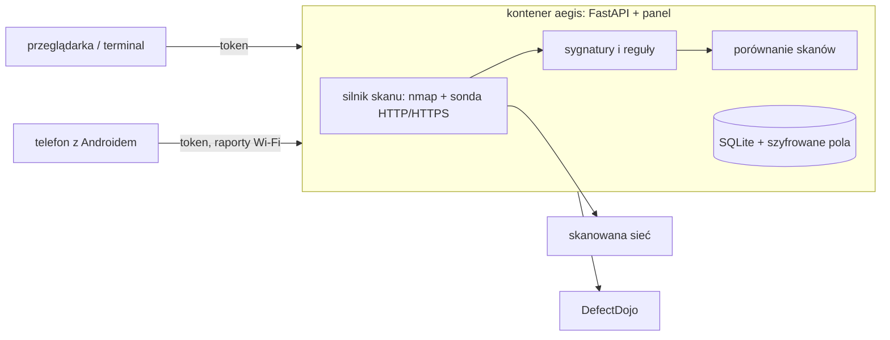

# AEGIS MESH

**Attack Surface Intelligence dla dużych sieci: regularne skanowanie, rozpoznawanie technologii,
priorytety z uzasadnieniem i raport „co się zmieniło” po każdym skanie.**

Projekt drużyny Team Panda na wyzwanie AGH (Centrum Bezpieczeństwa Informacji) „Attack Surface Intelligence”.

AEGIS MESH skanuje sieć (np. uczelni), znajduje hosty i usługi, rozpoznaje technologie, nadaje tagi
i priorytet 1–5 z uzasadnieniem po polsku, a po każdym skanie porównuje wynik z poprzednim.
Ważne znaleziska trafiają do DefectDojo. Telefon z Androidem pokazuje alerty i działa jako czujnik
Wi-Fi, który wykrywa obce punkty dostępowe i evil twin sieci organizacji.

Wszystko działa lokalnie w Dockerze, na darmowych narzędziach open source, bez chmury i bez AI:
każdą decyzję systemu da się wyjaśnić konkretną regułą lub sygnaturą.


## Serwer demonstracyjny dla jury

Działająca instancja AEGIS MESH na laptopie drużyny, bez instalowania czegokolwiek:

| | |
|---|---|
| Adres | https://aegis.tail36df25.ts.net |
| Login | `Kacperlagodowski` |
| Hasło | `Kacperlagodowski` |

Serwer jest dostępny tylko wtedy, gdy laptop drużyny jest włączony i ma uruchomiony
Docker oraz Tailscale Funnel. Jeśli strona się nie otwiera, użyj instrukcji poniżej
i uruchom system u siebie.

## Dla jury: krok po kroku

Całość działa na jednym komputerze. Internet jest potrzebny tylko do pobrania i zbudowania obrazów Dockera.
Potrzebne są: **Git**, **Docker** z `docker compose` (na Windowsie i macOS: Docker Desktop,
uruchomiony przed startem) oraz (zalecane) 4 GB wolnej pamięci RAM i 10 GB miejsca na dysku, głównie dla DefectDojo.

1. **Pobierz projekt.** Linux i macOS: zwykły terminal. Windows: **Git Bash** (instaluje się z Git for Windows).

   ```bash
   git clone https://github.com/PI0B0R/AEGIS-MESH
   cd AEGIS-MESH
   ```

2. **Ustaw hasło admina panelu** (działa przy pierwszym starcie serwera; bez tego pokaz ustawi `pokaz-admin-haslo`):

   ```bash
   export AEGIS_ADMIN_PASSWORD='wybrane-dlugie-haslo'
   ```

3. **Uruchom pokaz z DefectDojo.** Skrypt sam zbuduje i uruchomi serwer, sieć testową i DefectDojo,
   a potem krok po kroku pokaże skany, zmiany, edycje, role, sygnatury, eksport i wysyłkę do DefectDojo.
   Enter przechodzi do następnego kroku. Pierwsze uruchomienie trwa około 10–15 minut
   (budowa obrazu i start DefectDojo).

   ```bash
   bash demo/pokaz.sh --dojo
   ```

4. **Zaloguj się do panelu:** http://127.0.0.1:8000, login `admin`, hasło z kroku 2.
   Dokumentacja API: http://127.0.0.1:8000/docs.
5. **DefectDojo:** http://127.0.0.1:8081, login `admin`, hasło `aegis-lab-dojo`
   (albo wartość `DOJO_ADMIN_PASSWORD`, jeśli była ustawiona przed pierwszym startem).
6. **Koniec pracy:** `docker compose --profile dojo --profile zmiana down`.
   Usunięcie także wszystkich danych: to samo polecenie z `-v` na końcu.

Gdy coś nie działa:

| Objaw | Co zrobić |
|---|---|
| `Cannot connect to the Docker daemon` | uruchom Docker Desktop (Windows, macOS) albo `sudo systemctl start docker` (Linux) |
| `permission denied` przy `docker` na Linuksie | dodaj się do grupy `docker` albo uruchamiaj polecenia z `sudo` |
| `port is already allocated` (8000 lub 8081) | zatrzymaj program, który zajmuje port, albo zmień `ports` w `docker-compose.yml` |
| hasło admina nie pasuje | hasło ustawia tylko pierwszy start; pokaz od zera: `bash demo/pokaz.sh --od-zera --dojo` (usuwa dane serwera) |
| `$'\r': command not found` (Windows) | sklonuj repozytorium ponownie przez `git clone` (nie z ZIP-a), skrypty mają wtedy poprawne końce linii |
| DefectDojo nie odpowiada od razu | pierwszy start trwa 3–5 minut; pokaz sam na niego czeka |

## Najważniejsze funkcje

| | |
|---|---|
| **Skanowanie dużych sieci** | cele jako IP, CIDR, zakresy, domeny, pliki CSV/JSON; kalibracja szybkości, podgrupy w wątkach, pauza i wznowienie, okna czasowe harmonogramu |
| **Bezpieczny skaner** | limit pakietów nmapa i zapytań HTTP, tylko wybrane porty, tylko GET bez logowania, formularzy i exploitów |
| **Rozpoznawanie** | nagłówki, ciasteczka, certyfikat TLS, hash favicony (mmh3 jak w Shodanie), tytuł, banery usług; własne sygnatury dodawane w panelu |
| **Priorytety 1–5** | z sygnatur i reguł (np. logowanie bez HTTPS = 5), każdy z powodem po polsku; ręczne edycje nie są nadpisywane przez kolejne skany |
| **Co się zmieniło** | nowe hosty i usługi, zmiany wersji i certyfikatów, hosty niestabilne, nieaktywne i aktywne tylko o określonej porze |
| **Radar Wi-Fi** | telefony porównują słyszane punkty dostępowe z listą znanych routerów i zgłaszają: nowy router, evil twin, słabsze zabezpieczenie, przeniesienie, zniknięcie |
| **Radar zakresów (BGP)** | porównuje prefiksy ogłaszane przez ASN organizacji (RIPEstat) z listą celów i pokazuje luki w pokryciu |
| **DefectDojo** | automatyczna wysyłka ważnych znalezisk bez duplikatów (`reimport-scan`) |
| **Bezpieczeństwo** | 4 role, szyfrowanie wrażliwych pól AES-256-GCM, scrypt, blokada po 5 błędnych hasłach, dziennik zmian, ścisłe CSP |

## Szybki start

Potrzebny jest tylko **Docker** z wtyczką compose (nmap jest w obrazie).

```bash
git clone https://github.com/PI0B0R/AEGIS-MESH && cd AEGIS-MESH
export AEGIS_ADMIN_PASSWORD='dlugie-haslo-admina'   # hasło admina, ustawiane przy pierwszym starcie
docker compose up -d --build
./demo/pokaz.sh              # cały scenariusz krok po kroku na sieci testowej
```

| Adres | Co |
|---|---|
| http://127.0.0.1:8000 | panel WWW (login `admin`) |
| http://127.0.0.1:8000/docs | dokumentacja API (OpenAPI) |
| http://127.0.0.1:8081 | DefectDojo (tylko z profilem `dojo`) |

Opcjonalne profile `docker compose`:

```bash
docker compose --profile dojo up -d      # testowa instancja DefectDojo
docker compose --profile zmiana up -d    # dodatkowy host w sieci testowej (zmiana między skanami)
./demo/pokaz.sh --dojo                   # pokaz razem z wysyłką do DefectDojo
```

Bez `AEGIS_ADMIN_PASSWORD` hasło admina jest losowane i zapisywane w `/data/admin-password.txt`
w kontenerze: `docker compose exec aegis cat /data/admin-password.txt`.

**Windows:** Docker Desktop, a skrypt pokazu uruchom w Git Bash (z Git for Windows) albo w WSL:
`bash demo/pokaz.sh`. Hasła najlepiej trzymać w pliku `.env` obok `docker-compose.yml`
(jest w `.gitignore`), np. `AEGIS_ADMIN_PASSWORD=...`, `DOJO_ADMIN_PASSWORD=...`.

## Jak to działa



1. **Cele** są rozwijane do listy adresów, a skan dzieli je na podgrupy wykonywane równolegle.
2. **nmap** znajduje otwarte porty i usługi z ustawionym limitem szybkości.
3. **Sonda HTTP/HTTPS** zbiera stronę, nagłówki, ciasteczka, certyfikat i faviconę.
4. **Sygnatury i reguły** tworzą znaleziska z tagami, priorytetem i uzasadnieniem.
5. **Porównanie** z poprzednim skanem zapisuje zmiany widoczne w „Co nowego”.
6. **DefectDojo** dostaje nowe znaleziska o priorytecie ≥ 4 (opcjonalnie, automatycznie).

Szczegóły: [docs/DOKUMENTACJA.md](docs/DOKUMENTACJA.md).

## Role

| Rola | Może |
|---|---|
| `czytelnik` | przeglądać wszystko i eksportować znaleziska |
| `analityk` | edytować znaleziska, wysyłać do DefectDojo, zarządzać znanymi routerami Wi-Fi |
| `edytor` | cele, skany, harmonogram, sygnatury, ustawienia skanera, radar BGP |
| `admin` | użytkownicy, dziennik, ustawienia DefectDojo, agenci (telefony i skaner), pełny eksport i import |

Konta zakłada tylko admin (brak samodzielnej rejestracji). Każda rola ma też prawa ról niższych.

## Terminal

Komenda `aegis` korzysta z tego samego API co panel:

```bash
docker compose exec aegis aegis targets add 172.30.0.0/24
docker compose exec aegis aegis scan start
docker compose exec aegis aegis changes
docker compose exec aegis aegis findings list --min-priority 4
docker compose exec aegis aegis --help
```

Z innego komputera wystarczą zmienne `AEGIS_URL` i `AEGIS_TOKEN`.

## Testy

```bash
cd server
pip install -r requirements-dev.txt -e .
pytest -q                                          # testy jednostkowe (126)
AEGIS_URL=http://127.0.0.1:8000 pytest -q -m lab   # na żywej sieci testowej (po docker compose up)
cd ../android-app && ./gradlew testDebugUnitTest   # logika aplikacji (wymaga JDK 17 i Android SDK)
```

GitHub Actions uruchamia testy jednostkowe, testy na sieci testowej z DefectDojo, testy panelu
w Chromium i cały skrypt pokazu, a dla `android-app/` testy i budowę APK
(wydanie [apk-latest](https://github.com/PI0B0R/AEGIS-MESH/releases/tag/apk-latest)).

## Struktura repozytorium

| Katalog | Zawartość |
|---|---|
| `server/` | serwer: Python 3.11+, FastAPI, SQLite, nmap; panel WWW w `server/aegis/panel/` (HTML, CSS, JS bez frameworków) |
| `android-app/` | aplikacja na Androida (Kotlin): Pulpit, Alerty, Radar Wi-Fi |
| `lab/` | strony sieci testowej używane przez `docker-compose.yml` |
| `demo/` | skrypt pokazu dla jury `pokaz.sh` |
| `docs/` | dokumentacja techniczna i zrzuty ekranu |
| `aegis-web/` | wcześniejszy prototyp (pomiary Wi-Fi z laptopa, mapa kampusu); nie jest częścią obecnego systemu |
| `.github/workflows/` | CI serwera i budowa APK |

## Dokumenty

| | |
|---|---|
| [docs/DOKUMENTACJA.md](docs/DOKUMENTACJA.md) | dokumentacja techniczna: architektura, skan, bezpieczeństwo, dane, role, API, Wi-Fi, testy |
| [server/README.md](server/README.md) | obsługa krok po kroku: cele, skany, harmonogram, sygnatury, DefectDojo, eksport |
| [android-app/README.md](android-app/README.md) | aplikacja na telefon, Tailscale Funnel, kompilacja APK |
| [demo/pokaz.sh](demo/pokaz.sh) | pokaz: 5 skanów ze zmianami, edycje, role, sygnatury, eksport i import |
| [ZAMYSL_PROJEKTU.md](ZAMYSL_PROJEKTU.md) | pierwotny zamysł projektu |

## Technologie

Python, FastAPI, uvicorn, SQLite (WAL), `cryptography`, nmap, Docker Compose, nginx, DefectDojo,
Kotlin (Android SDK 35, min. Android 8.0), Leaflet, Tailscale Funnel (opcjonalnie, na pokaz).

## Ważne

Skanuj wyłącznie sieci, do których masz uprawnienia. Domyślnie panel nasłuchuje tylko na `127.0.0.1`;
`AEGIS_BIND=0.0.0.0` udostępnia go w sieci lokalnej.
