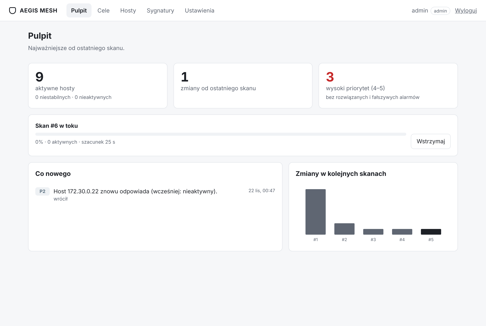

# AEGIS MESH

System do regularnego skanowania dużych sieci (np. sieci uczelni): znajduje hosty i usługi,
rozpoznaje technologie, nadaje tagi i priorytet 1–5 z uzasadnieniem po polsku
i po każdym skanie pokazuje, co się zmieniło. Działa lokalnie w Dockerze, bez chmury i bez AI,
na darmowych narzędziach open source.



## Szybki start

```bash
AEGIS_ADMIN_PASSWORD='dlugie-haslo-admina' docker compose up -d --build
./demo/pokaz.sh              # cały scenariusz krok po kroku na sieci testowej
```

Panel: http://127.0.0.1:8000 (login `admin`), API: http://127.0.0.1:8000/docs.

Na Windows: Docker Desktop, a skrypt pokazu uruchom w **Git Bash** (instaluje się z Git for Windows)
albo w WSL: `bash demo/pokaz.sh`. Hasła do `docker compose` najlepiej trzymać w pliku `.env`
obok `docker-compose.yml` (jest w `.gitignore`), np. `DOJO_ADMIN_PASSWORD=...`.

## Dokumenty

| | |
|---|---|
| [docs/DOKUMENTACJA.md](docs/DOKUMENTACJA.md) | dokumentacja techniczna: architektura, bezpieczeństwo, dane, role, API, testy |
| [server/README.md](server/README.md) | obsługa krok po kroku: cele, skany, harmonogram, sygnatury, DefectDojo, eksport |
| [demo/pokaz.sh](demo/pokaz.sh) | pokaz dla jury: 5 skanów ze zmianami, edycje, role, sygnatury, eksport i import |
| [android-app/README.md](android-app/README.md) | aplikacja na telefon i Tailscale Funnel |
| [ZAMYSL_PROJEKTU.md](ZAMYSL_PROJEKTU.md) | pierwotny zamysł projektu |

## Katalogi

- `server/`: serwer (Python, FastAPI, SQLite, nmap) i panel WWW
- `lab/`: strony sieci testowej z `docker-compose.yml`
- `demo/`: skrypt pokazu
- `docs/`: dokumentacja i zrzuty ekranu
- `android-app/`: aplikacja na Androida (Pulpit, Alerty, Radar Wi-Fi), opis w [android-app/README.md](android-app/README.md)
- `aegis-web/`: wcześniejszy prototyp
