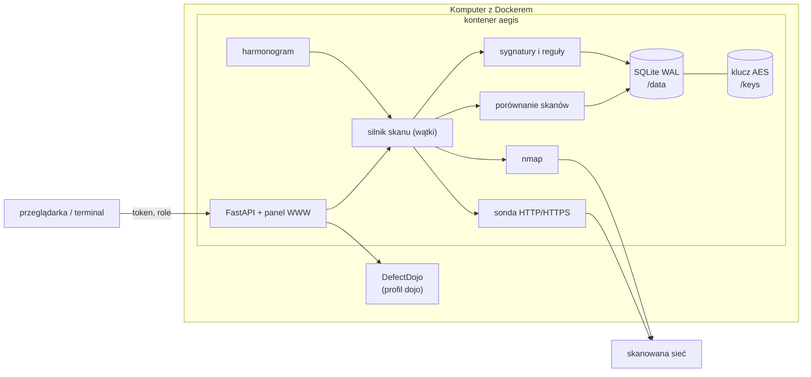
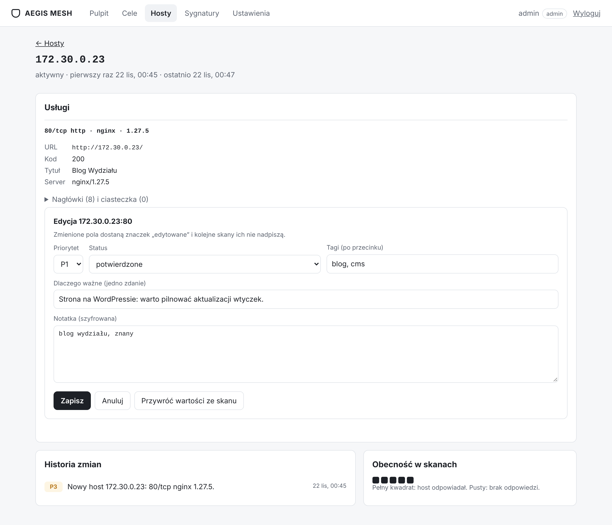
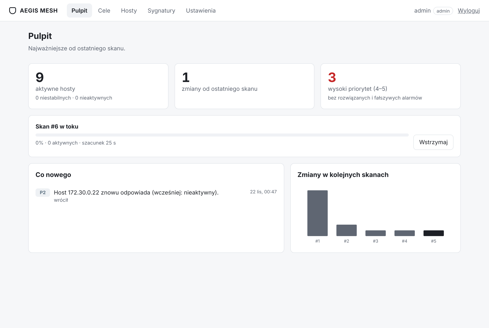
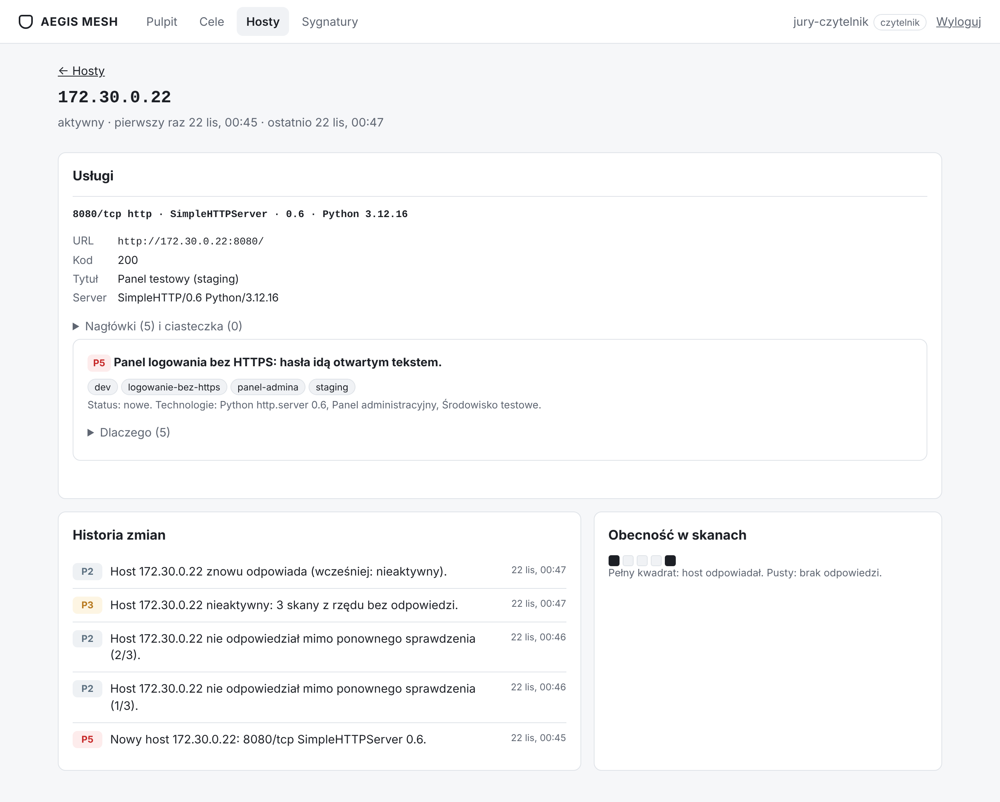
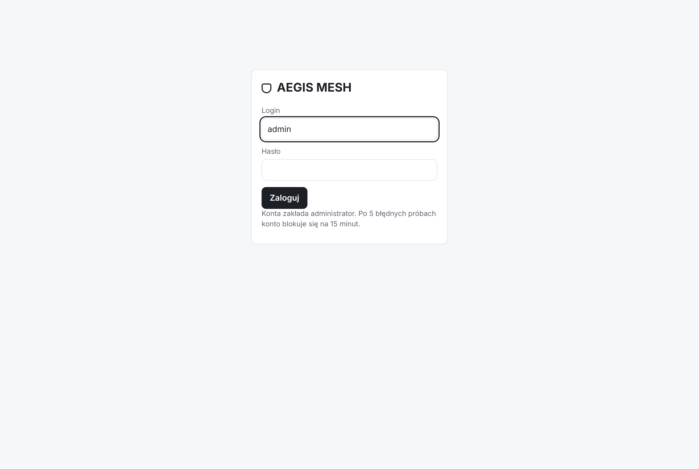
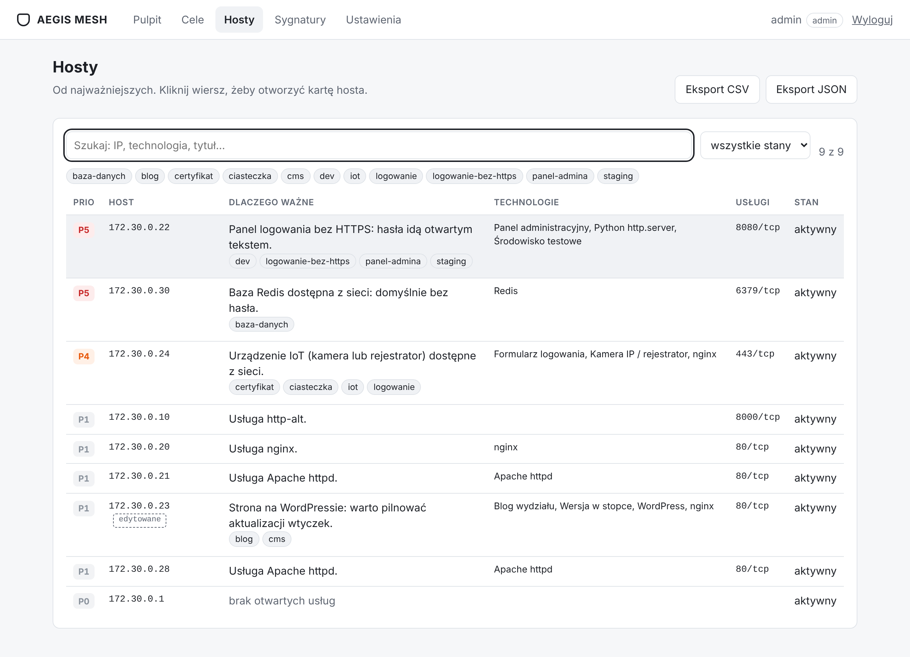
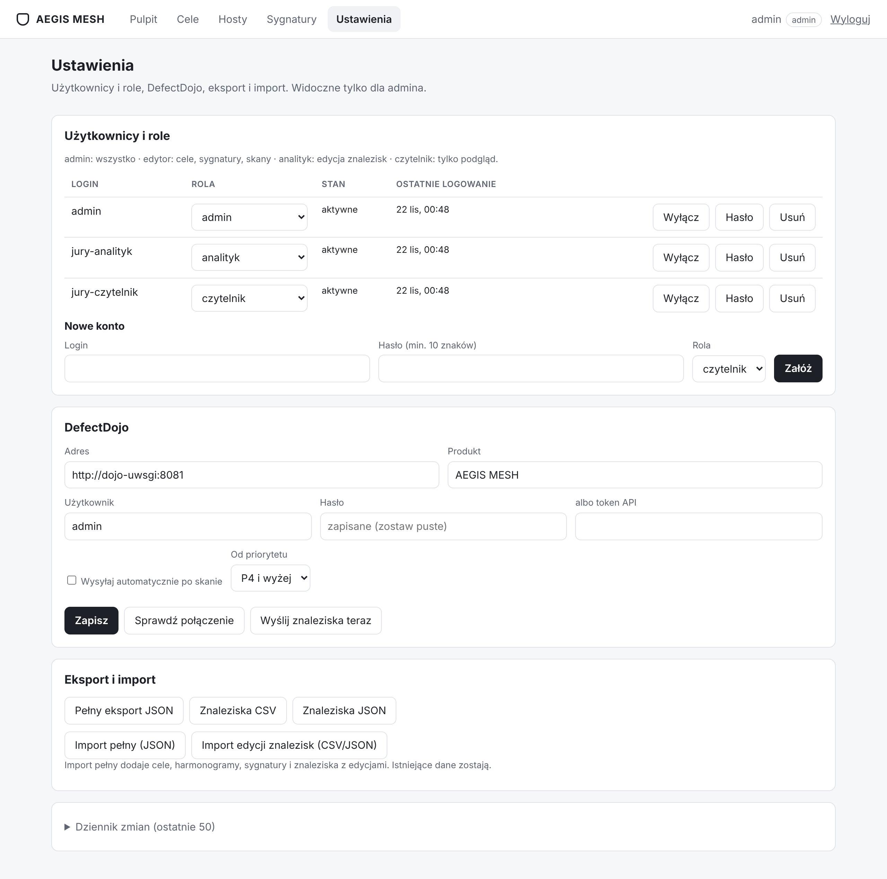

# AEGIS MESH: dokumentacja techniczna

Wersja 0.5.0. Dokument opisuje serwer, panel WWW i sieć testową. Instrukcja obsługi
krok po kroku jest w [`server/README.md`](../server/README.md), a pokaz dla jury w [`demo/pokaz.sh`](../demo/pokaz.sh).

Spis treści:

1. [Co robi system](#1-co-robi-system)
2. [Architektura](#2-architektura)
3. [Instalacja i uruchomienie](#3-instalacja-i-uruchomienie)
4. [Przebieg skanu](#4-przebieg-skanu)
5. [Bezpieczeństwo skanowania](#5-bezpieczeństwo-skanowania)
6. [Rozpoznawanie i sygnatury](#6-rozpoznawanie-i-sygnatury)
7. [Znaleziska i priorytety](#7-znaleziska-i-priorytety)
8. [Porównanie skanów i hosty niestabilne](#8-porównanie-skanów-i-hosty-niestabilne)
9. [Model danych](#9-model-danych)
10. [Bezpieczeństwo serwera](#10-bezpieczeństwo-serwera)
11. [Role i uprawnienia](#11-role-i-uprawnienia)
12. [Panel WWW](#12-panel-www)
13. [API i terminal](#13-api-i-terminal)
14. [DefectDojo](#14-defectdojo)
15. [Eksport i import](#15-eksport-i-import)
16. [Testy](#16-testy)
17. [Telefon i Tailscale Funnel](#17-telefon-i-tailscale-funnel)
18. [Ograniczenia i dalsze kroki](#18-ograniczenia-i-dalsze-kroki)

## 1. Co robi system

AEGIS MESH regularnie skanuje duże sieci (np. sieć uczelni), rozpoznaje usługi i technologie,
nadaje im tagi i priorytet 1–5 z uzasadnieniem po polsku, a po każdym skanie pokazuje,
co się zmieniło. Wszystko działa lokalnie na jednym komputerze z Dockerem.

Założenia projektu:

- tylko darmowe narzędzia open source (Python, FastAPI, SQLite, nmap, nginx, DefectDojo);
- bez AI i bez usług w chmurze: każdą decyzję da się wyjaśnić regułą lub sygnaturą;
- skaner jest bezpieczny: limit szybkości, tylko wybrane porty, tylko odczyt
  (bez logowania, bez formularzy, bez exploitów);
- dane wrażliwe są w bazie zaszyfrowane.

## 2. Architektura



| Moduł (`server/aegis/`) | Odpowiada za |
|---|---|
| `targets.py` | parser celów: IP, CIDR, zakresy, domeny; CSV i JSON |
| `scanner.py` | wywołanie nmapa i odczyt jego XML |
| `engine.py` | skan: kalibracja, podgrupy, wątki, pauza i wznowienie, ponowne sprawdzenie hostów |
| `web.py` | sonda HTTP/HTTPS: strona, nagłówki, ciasteczka, certyfikat, favicona, ścieżki |
| `signatures.py`, `signatures.json` | sygnatury technologii i reguły priorytetu |
| `findings.py` | znaleziska: wartości automatyczne i ręczne edycje |
| `diff.py` | zmiany między skanami, hosty niestabilne i nieaktywne, pory dnia |
| `scheduler.py` | okna czasowe i częstotliwość |
| `dojo.py` | wysyłka do DefectDojo |
| `auth.py` | konta, role, tokeny, blokada po błędnych hasłach |
| `crypto.py` | szyfrowanie pól AES-256-GCM |
| `db.py` | schemat bazy i migracje |
| `api.py`, `api_results.py`, `api_admin.py` | REST API |
| `cli.py` | komenda `aegis` w terminalu |
| `panel/` | panel WWW (HTML, CSS, JavaScript bez frameworków) |

Serwer to jeden proces uvicorn. Harmonogram i skany działają w wątkach tego procesu,
a stan skanu jest w bazie, więc restart nie gubi postępu.

## 3. Instalacja i uruchomienie

Potrzebny jest tylko Docker z wtyczką compose. nmap jest w obrazie serwera.

```bash
git clone https://github.com/PI0B0R/AEGIS-MESH && cd AEGIS-MESH
AEGIS_ADMIN_PASSWORD='dlugie-haslo-admina' docker compose up -d --build
```

- Panel: http://127.0.0.1:8000 (login `admin`).
- Dokumentacja API: http://127.0.0.1:8000/docs.
- Pokaz całego scenariusza: `./demo/pokaz.sh` (z `--dojo` także DefectDojo).

Zmienne środowiskowe:

| Zmienna | Domyślnie | Znaczenie |
|---|---|---|
| `AEGIS_ADMIN_PASSWORD` | losowe, zapisane w `/data/admin-password.txt` (0600) | hasło pierwszego admina |
| `AEGIS_BIND` | `127.0.0.1` | adres, na którym panel nasłuchuje (`0.0.0.0` otwiera go w sieci) |
| `AEGIS_TZ` | `Europe/Warsaw` | strefa czasu harmonogramu i pór dnia |
| `AEGIS_KEY` | plik `/keys/aegis.key` | klucz szyfrowania (base64) zamiast pliku |
| `AEGIS_DOJO_URL`, `_USER`, `_PASSWORD` | lab DefectDojo | DefectDojo do czasu ustawienia go w panelu |
| `DOJO_ADMIN_PASSWORD` | `aegis-lab-dojo` | hasło admina testowego DefectDojo |

Dane leżą w dwóch wolumenach: `aegis-data` (baza) i `aegis-keys` (klucz). Kopia zapasowa
to kopia obu wolumenów albo pełny eksport JSON (sekcja 15).

### Sieć testowa

`docker compose` stawia też małą sieć `172.30.0.0/24`, która udaje typowe przypadki z uczelni:

| Adres | Usługa | Czego się spodziewać |
|---|---|---|
| .20 | nginx | serwer WWW z wersją |
| .21 | Apache httpd | serwer WWW z wersją |
| .22 | „staging”, port 8080 | panel logowania bez HTTPS, priorytet 5 |
| .23 | strona na WordPressie | CMS z wersją |
| .24 | „kamera IP” na HTTPS | certyfikat self-signed, IoT |
| .28 | nowy serwer (profil `zmiana`) | pojawia się między skanami |
| .30 | Redis | baza danych dostępna w sieci |

## 4. Przebieg skanu

1. **Cele** są rozwijane do listy adresów (CIDR, zakresy, domeny przez DNS).
2. **Kalibracja.** Pierwszy skan zaczyna od podgrupy 16 adresów i mierzy, ile adresów nmap
   sprawdza na sekundę przy ustawionym limicie.
3. **Podgrupy.** Reszta jest dzielona na podgrupy po około 60 s pracy (8–256 adresów).
   Podgrupy idą równolegle w `threads` wątkach (domyślnie 4).
4. **Rozpoznanie.** Każda znaleziona usługa WWW dostaje sondę HTTP/HTTPS (sekcja 6).
5. **Analiza.** Sygnatury i reguły tworzą znaleziska z tagami i priorytetem.
6. **Ponowne sprawdzenie.** Hosty znane z poprzednich skanów, które nie odpowiedziały,
   trafiają do jednej dodatkowej podgrupy (`kind='recheck'`).
7. **Porównanie** z poprzednim skanem zapisuje zmiany (sekcja 8).
8. **DefectDojo** (opcjonalnie): nowe ważne znaleziska są wysyłane automatycznie.

Czas każdej podgrupy jest zapisany, więc `GET /api/scans/estimate` podaje realny szacunek
czasu następnego skanu. Skan można wstrzymać i wznowić. Skan, który nie zmieści się w oknie
harmonogramu, zostaje wstrzymany o końcu okna i wznowiony w następnym oknie.

Harmonogram ma szablony (`nocny` 22:00–06:00, `weekend`, `co-6-godzin`, `co-godzine`) i własne
ustawienia: częstotliwość `daily`, `weekly:0-6`, `every:Nh` oraz okno `HH:MM-HH:MM`.

## 5. Bezpieczeństwo skanowania

| Zabezpieczenie | Ustawienie | Domyślnie |
|---|---|---|
| limit pakietów nmapa (`--max-rate`) | `rate` | 300/s |
| tylko wybrane porty | `ports` | 21, 22, 23, 25, 53, 80, 110, 143, 443, 445, 1883, 3306, 3389, 5432, 5900, 6379, 8000, 8080, 8443, 9200 |
| lekkie rozpoznawanie wersji | `-sV --version-light` | zawsze |
| limit zapytań HTTP | `http_rate` | 10/s na cały skan |
| limit czasu zapytania HTTP | `http_timeout` | 6 s |
| tylko GET, bez formularzy i logowania | w kodzie | zawsze |
| przekierowania tylko w obrębie hosta | w kodzie | zawsze |
| sygnatury tylko wykrywają | w kodzie | brak sygnatur, które coś wysyłają |
| lista ścieżek z góry | `signatures.json` | `/admin/`, `/login`, `/version`, `/server-status`, `/.git/HEAD` |

Sygnatura rodzaju `path` może tylko dopisać ścieżkę do krótkiej listy GET. Nie da się nią
wysłać danych ani parametrów. Ustawienia skanera może zmieniać rola `edytor` i wyżej,
a każda zmiana trafia do dziennika.

## 6. Rozpoznawanie i sygnatury

Sonda HTTP/HTTPS (`web.py`) dla każdej usługi WWW zbiera:

- kod odpowiedzi, tytuł, nagłówki i pierwsze 64 KB strony;
- ciasteczka z flagami `Secure`, `HttpOnly`, `SameSite`;
- certyfikat TLS: wystawca, podmiot, SAN, daty ważności, czy jest self-signed;
- hash favicony mmh3 (ten sam co w Shodanie) i md5;
- odpowiedzi na ścieżki z listy sygnatur.

Sygnatura to nazwa, rodzaj, wyrażenie regularne, priorytet, tagi i zdanie wyjaśnienia.
Rodzaje: `header`, `cookie`, `html`, `title`, `favicon`, `path`, `service` (baner nmapa), `tls`.
Grupa w nawiasach w wyrażeniu to wersja, np. `nginx/([\d.]+)`.

Wbudowane sygnatury (`signatures.json`) obejmują serwery WWW, frameworki, CMS
(WordPress, Joomla, Drupal), panele administracyjne, strony staging/test, urządzenia IoT
(kamery, routery, drukarki, MQTT), bazy danych i usługi bez szyfrowania.
Własne sygnatury dodaje się w panelu (ekran Sygnatury) albo komendą `aegis signatures add`.
Przycisk „Sprawdź na istniejących hostach” pokazuje trafienia bez zapisu, a zapis od razu
przelicza znaleziska na zapisanych danych, bez nowego skanu.


Poza sygnaturami działają reguły, m.in.:

- formularz z polem hasła przez HTTP: priorytet 5, tag `logowanie-bez-https`;
- certyfikat wygasły (priorytet 3) lub self-signed (priorytet 2);
- ciasteczko sesji bez `HttpOnly`, ciasteczko na HTTPS bez `Secure`.

Usługi bez szyfrowania (Telnet, FTP) i bazy danych dostępne w sieci (Redis, Elasticsearch,
MySQL, PostgreSQL) mają własne sygnatury rodzaju `service`.

## 7. Znaleziska i priorytety

Znalezisko to jedna usługa (`ip`, `port`, `proto`) z technologiami, tagami, priorytetem 1–5,
tytułem, powodami i notatką. Priorytet to najwyższy priorytet z trafionych sygnatur i reguł,
a powody wyjaśniają go po polsku, np. „Panel logowania bez HTTPS: hasła idą otwartym tekstem”.

| Priorytet | Znaczenie | Przykład |
|---|---|---|
| 5 | pilne | logowanie bez HTTPS, Redis lub Elasticsearch dostępny z sieci |
| 4 | ważne | panel admina, strona staging, kamera IP |
| 3 | do przejrzenia | CMS z wersją, wygasły certyfikat |
| 2 | informacja | serwer WWW z wersją, certyfikat self-signed |
| 1 | tło | usługa bez uwag |

Pole zmienione ręcznie (tagi, priorytet, notatka, status) dostaje znaczek „edytowane”
i kolejne skany go nie nadpisują. Skan dalej liczy wartość automatyczną, więc „Przywróć”
oddaje pole skanom z aktualną wartością.



## 8. Porównanie skanów i hosty niestabilne

Po każdym skanie `diff.py` porównuje go z poprzednim i zapisuje zmiany:

| Zmiana | Kiedy |
|---|---|
| nowy host | adres pierwszy raz odpowiedział |
| nowa usługa / usługa zniknęła | port otwarty lub zamknięty względem poprzedniego skanu |
| zmiana | wersja, produkt, tytuł strony, kod HTTP, certyfikat |
| host niestabilny | host nie odpowiedział także przy ponownym sprawdzeniu |
| host nieaktywny | brak odpowiedzi w 3 kolejnych skanach (`unstable_after`) |
| host wrócił | nieaktywny lub niestabilny host znów odpowiada |
| odpowiada o określonej porze | host widać np. tylko w nocy (tabela `host_presence`) |

Zmiany są posortowane od najważniejszej (priorytet, potem rodzaj) i pokazane na pulpicie
w „Co nowego”. Jednorazowy brak odpowiedzi nie jest zgłaszany jako zniknięcie hosta,
bo host przechodzi najpierw przez ponowne sprawdzenie i stan „niestabilny”.



## 9. Model danych

Baza SQLite w trybie WAL (`/data/aegis.sqlite3`). Najważniejsze tabele:

| Tabela | Zawartość |
|---|---|
| `targets` | cele z notatką i stanem włączenia |
| `scan_runs`, `scan_chunks` | skany i ich podgrupy: adresy, stan, czas, rodzaj (`scan`/`recheck`) |
| `hosts`, `host_results` | hosty i ich wynik w każdym skanie |
| `services` | otwarte porty z banerem nmapa |
| `web` | dane z sondy HTTP/HTTPS |
| `findings` | znaleziska: wartości automatyczne, ręczne edycje, lista pól edytowanych |
| `changes` | zmiany po każdym skanie |
| `host_presence` | o jakich godzinach host odpowiada |
| `signatures` | własne sygnatury |
| `schedules` | harmonogramy |
| `users`, `sessions`, `audit` | konta, sesje (skróty tokenów), dziennik |
| `settings` | ustawienia skanera i DefectDojo |

Starsze bazy są uzupełniane przy starcie (lista `MIGRATIONS` w `db.py`), więc aktualizacja
nie wymaga ręcznych kroków.

## 10. Bezpieczeństwo serwera

- **Szyfrowanie pól.** AES-256-GCM, losowy nonce dla każdej wartości, nazwa kolumny jako
  dane uwierzytelniające (AAD), więc wartości nie da się przenieść do innej kolumny.
  Szyfrowane są: notatki, banery usług, dane HTTP (nagłówki, ciasteczka, treść, tytuł),
  technologie, tytuły, powody i notatki znalezisk, opisy zmian, hasło i token DefectDojo.
  Jawne zostają adresy, porty, priorytety, tagi i stany, żeby listy dało się filtrować.
- **Klucz** leży w osobnym wolumenie (`/keys`), nie w bazie. Kopia samej bazy bez klucza
  nie ujawnia treści.
- **Hasła** to skróty scrypt. Tokeny sesji są zapisane jako skróty SHA-256 i wygasają po 12 h.
- **Logowanie:** po 5 błędnych hasłach konto blokuje się na 15 minut. Nieznany login
  dostaje tę samą odpowiedź co złe hasło. Zmiana roli, hasła lub wyłączenie konta kończą sesje.
- **Brak samodzielnej rejestracji.** Konta zakłada tylko admin. Ostatniego admina nie można
  usunąć ani zdegradować.
- **Dziennik.** Każde logowanie i każda zmiana przez API trafia do tabeli `audit`.
- **Nagłówki** każdej odpowiedzi: CSP bez skryptów i stylów inline, `X-Frame-Options: DENY`,
  `X-Content-Type-Options: nosniff`, `Referrer-Policy: no-referrer`.
- **Panel** buduje stronę wyłącznie przez `textContent`, więc dane ze skanowanej sieci
  (tytuły, nagłówki) nie mogą wstrzyknąć HTML ani skryptu.
- **Sieć.** Domyślnie panel nasłuchuje tylko na `127.0.0.1`.

## 11. Role i uprawnienia

Każda rola ma też prawa ról niższych.

| Rola w zadaniu | Rola | Może |
|---|---|---|
| Odczyt | `czytelnik` | przeglądać pulpit, hosty, znaleziska, zmiany, sygnatury, eksport znalezisk |
| Modyfikacja i odczyt | `analityk` | edytować znaleziska, importować edycje, wysyłać do DefectDojo |
| Dodawanie, usuwanie, modyfikacja | `edytor` | cele, skany, harmonogram, sygnatury, ustawienia skanera |
| Administracja | `admin` | użytkownicy, dziennik, ustawienia DefectDojo, pełny eksport i import |

Każda ścieżka API ma przypisaną minimalną rolę w tabeli `PERMISSIONS` w `auth.py`.
Ścieżka, której tam brak, wymaga admina, a test `test_every_api_route_has_a_permission`
pilnuje, żeby żadna nowa ścieżka nie została bez wpisu. Panel nie pokazuje przycisków,
do których użytkownik nie ma prawa (lista praw z `GET /api/auth/me`).



## 12. Panel WWW

Pięć ekranów, jeden kolor tylko dla priorytetu, działa też na telefonie i w trybie ciemnym.

| Ekran | Zawartość |
|---|---|
| Pulpit | kafelki: aktywne hosty, zmiany, wysoki priorytet; „Co nowego”; wykres zmian; ostatni i następny skan; „Skanuj teraz” |
| Cele | jedno pole na adresy lub plik CSV/JSON, harmonogram jednym kliknięciem, ustawienia skanera pod „Zaawansowane” |
| Hosty | tabela z wyszukiwarką i filtrami po tagach, karta hosta z usługami, certyfikatem, historią i edycją |
| Sygnatury | formularz i test na istniejących hostach |
| Ustawienia | konta, DefectDojo, eksport i import, dziennik |

| | |
|---|---|
|  |  |
|  |  |



## 13. API i terminal

REST API z dokumentacją OpenAPI pod `/docs`. Wszystko poza `GET /api/health`,
`POST /api/auth/login` i stroną panelu wymaga nagłówka `Authorization: Bearer <token>`.

| Grupa | Najważniejsze ścieżki |
|---|---|
| logowanie | `POST /api/auth/login`, `/logout`, `/password`, `GET /api/auth/me` |
| cele | `GET/POST /api/targets`, `POST /api/targets/import`, `PATCH/DELETE /api/targets/{id}` |
| skany | `POST /api/scans`, `GET /api/scans`, `/estimate`, `/{id}`, `/{id}/pause`, `/{id}/resume` |
| harmonogram | `GET/POST /api/schedules`, `/templates`, `DELETE /api/schedules/{id}` |
| pulpit | `GET /api/summary`, `/api/changes`, `/api/changes/history` |
| hosty | `GET /api/inventory`, `/api/hosts`, `/api/hosts/unstable`, `/api/hosts/{ip}` |
| znaleziska | `GET /api/findings`, `PATCH /api/findings/{id}`, `POST /api/findings/{id}/reset` |
| sygnatury | `GET/POST /api/signatures`, `POST /api/signatures/test`, `DELETE /api/signatures/{id}` |
| eksport | `GET /api/export/findings?format=csv`, `GET /api/export/full`, `POST /api/import/findings`, `/api/import/full` |
| DefectDojo | `POST /api/dojo/check`, `/api/dojo/send` |
| admin | `GET/POST /api/users`, `PATCH/DELETE /api/users/{id}`, `GET /api/audit` |

Komenda `aegis` w kontenerze serwera korzysta z tego samego API z tokenem terminala
(`/data/cli.token`, nowy przy każdym starcie, uprawnienia admina). Z innego komputera
wystarczą zmienne `AEGIS_URL` i `AEGIS_TOKEN`. Pełna lista komend: `aegis --help`.

## 14. DefectDojo

- Testowa instancja jest w `docker compose` pod profilem `dojo` (obrazy 3.5.103).
- Produkt, engagement i test DefectDojo tworzy sam (`auto_create_context`), a znaleziska wysyła przez `reimport-scan`
  w formacie „Generic Findings Import” z severity Info i dowodami (URL, tytuł, nagłówek
  `Server`, certyfikat, powody, notatka analityka).
- Ponowna wysyłka aktualizuje ten sam test, więc nie tworzy duplikatów.
- `dojo_auto=true` wysyła nowe ważne znaleziska po każdym skanie.
- Adres i token innej instancji ustawia admin w panelu lub komendą `aegis settings`.
  Token jest w bazie zaszyfrowany.

## 15. Eksport i import

| Co | Format | Rola |
|---|---|---|
| znaleziska | CSV, JSON | czytelnik |
| edycje znalezisk (tagi, priorytet, notatki, status) | import CSV, JSON | analityk |
| cele | import CSV, JSON | edytor |
| pełny stan: cele, harmonogramy, sygnatury, hosty, znaleziska | JSON | admin |

Import edycji zmienia tylko pola, które różnią się od obecnego stanu, i oznacza je jako
edytowane. Pełny import dokłada dane do istniejących (np. przeniesienie na nowy serwer).

## 16. Testy

| Zestaw | Co sprawdza | Jak uruchomić |
|---|---|---|
| jednostkowe (~100) | parser celów, szyfrowanie, silnik z udawanym nmapem, sonda HTTP na lokalnym serwerze, sygnatury, porównanie, harmonogram, role i każda ścieżka API, DefectDojo na atrapie | `cd server && pytest -q` |
| lab | 5 prawdziwych skanów sieci testowej: nowy host, host milknie, niestabilny, nieaktywny, wraca; edycje przetrwają skany; sygnatura; eksport i import; role | `AEGIS_URL=http://127.0.0.1:8000 pytest -q -m lab` |
| lab + DefectDojo | to samo i wysyłka bez duplikatów | `AEGIS_LAB_DOJO=1` do powyższego |
| przeglądarka | panel w Chromium: logowanie, 5 ekranów, ukrywanie przycisków, brak błędów CSP | `AEGIS_ADMIN_PASSWORD=... pytest -q -m lab tests/test_panel_browser.py` |
| pokaz | cały scenariusz jury od początku do końca | `./demo/pokaz.sh --bez-pauz --dojo` |

GitHub Actions (`.github/workflows/server.yml`) uruchamia testy jednostkowe, a potem
`docker compose` z DefectDojo, testy labu, testy w przeglądarce i skrypt pokazu.

## 17. Telefon i Tailscale Funnel

Aplikacja na Androida (`android-app/`, szczegóły w [jej README](../android-app/README.md)) to dodatek
na pokaz. Korzysta z tego samego API, logowania i ról co panel.

| Zakładka | Zawartość |
|---|---|
| Pulpit | kafelki, ostatni i następny skan, „Co nowego”, „Skanuj teraz” (edytor, admin) |
| Alerty | znaleziska 4–5, przycisk „Sprawdzone” (analityk i wyżej), powiadomienia co 15 minut |
| Radar Wi-Fi | punkty dostępowe w pobliżu i radar ciepło-zimno, bez wysyłania danych |

Połączenie z laptopem:

- **Tailscale Funnel** (tryb główny): `tailscale funnel --bg 8000` daje stały adres
  `https://aegis.<sieć>.ts.net` z darmowym certyfikatem. Adres jest wbudowany w APK
  (zmienna repozytorium `AEGIS_FUNNEL_URL`). Telefon nie potrzebuje Tailscale.
- **Sieć Wi-Fi** (tryb zapasowy): aplikacja przeszukuje swoją sieć /24 na porcie 8000
  i rozpoznaje serwer po `GET /api/health` (`"service": "aegis-mesh"`). Wymaga `AEGIS_BIND=0.0.0.0`.
- Ukryta opcja „inny serwer”: przytrzymanie logo na ekranie logowania.

Funnel wystawia serwer do internetu, dlatego logowanie jest zawsze wymagane, `/api/health` podaje
tylko nazwę, wersję i to, czy jest nmap, a tunel jest domyślnie wyłączony.

## 18. Ograniczenia i dalsze kroki

- Jeden serwer i jedna baza SQLite. Dla sieci rzędu /16 wystarcza, większe sieci warto
  dzielić na kilka instancji albo przejść na PostgreSQL.
- Rozpoznawanie opiera się na sygnaturach. Technologie bez sygnatury są widoczne jako
  baner nmapa i tytuł strony, a własną sygnaturę dodaje się w kilka sekund.
- Skan UDP nie jest włączony (wolny i głośny w dużych sieciach).
- Brak powiadomień e-mail; zmiany widać w panelu, w terminalu i w DefectDojo.
- Blokada konta po 5 błędnych hasłach chroni przed zgadywaniem, ale przez Funnel ktoś może celowo
  zablokować konto na 15 minut. Funnel warto włączać tylko na czas pokazu.
- Powiadomienia w telefonie przychodzą co 15 minut (najkrótszy okres w Androidzie), nie od razu.
