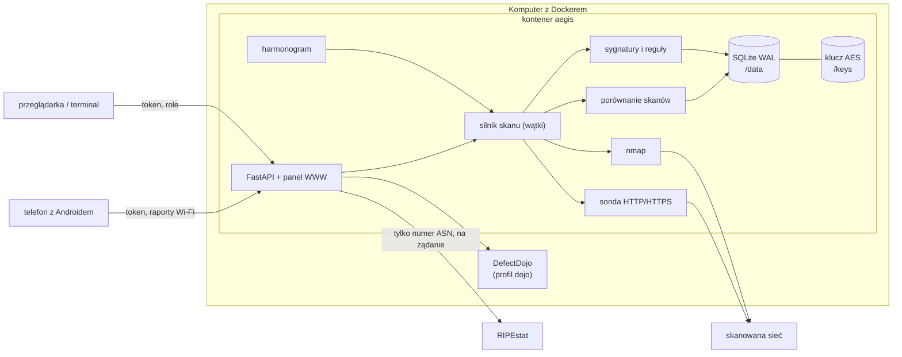
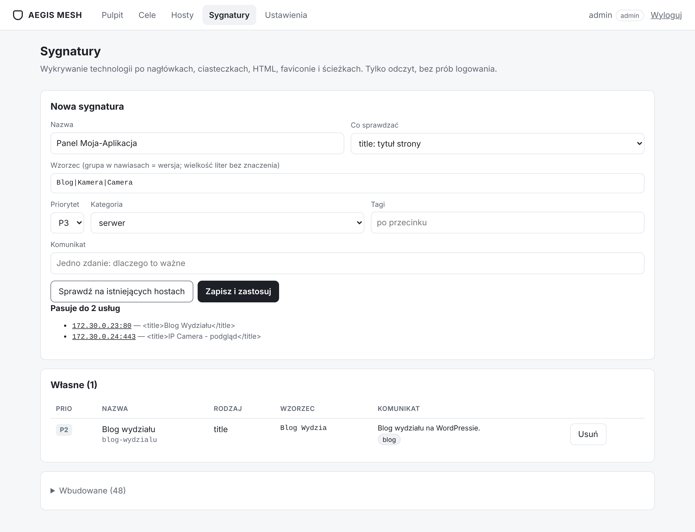
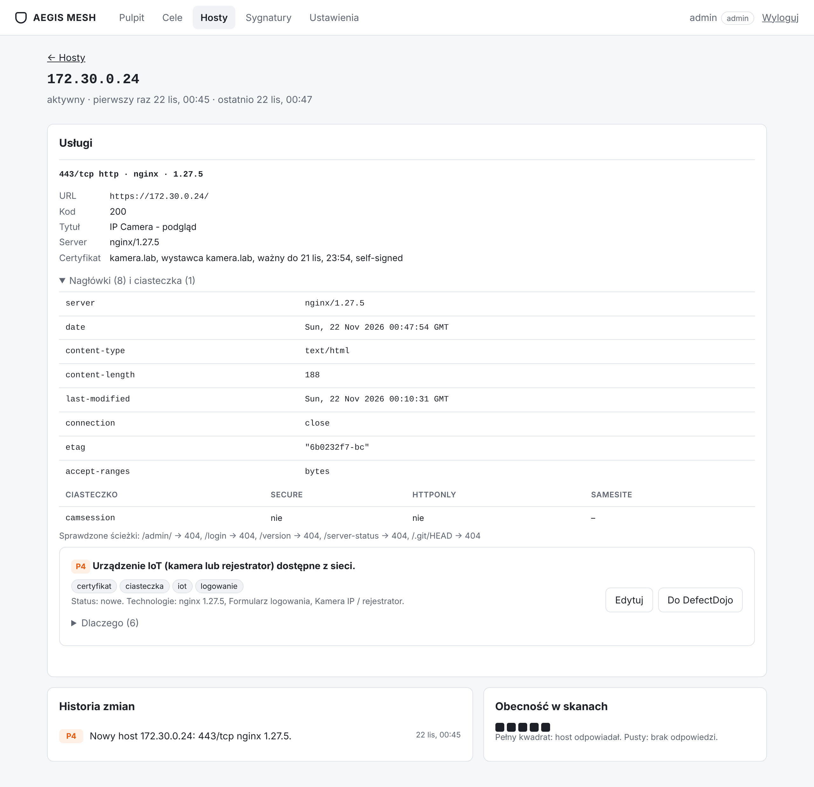
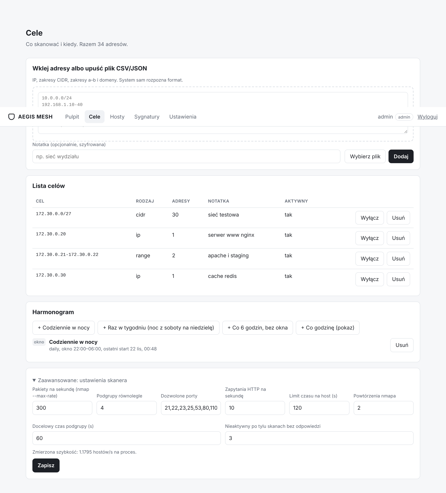

# AEGIS MESH: dokumentacja techniczna

Serwer w wersji 0.5.0, aplikacja na Androida w wersji 1.6. Dokument opisuje serwer, panel WWW,
radar Wi-Fi, aplikację na telefon, sieć testową i CI. Instrukcja obsługi
krok po kroku jest w [`server/README.md`](../server/README.md), a pokaz dla jury w [`demo/pokaz.sh`](../demo/pokaz.sh).

Spis treści:

1. [Co robi system](#1-co-robi-system)
2. [Architektura](#2-architektura)
3. [Instalacja i uruchomienie](#3-instalacja-i-uruchomienie)
4. [Przebieg skanu](#4-przebieg-skanu)
5. [Bezpieczeństwo skanowania](#5-bezpieczeństwo-skanowania)
6. [Rozpoznawanie i sygnatury](#6-rozpoznawanie-i-sygnatury)
7. [Znaleziska i priorytety](#7-znaleziska-i-priorytety)
8. [Porównanie skanów i hosty niestabilne](#8-porównanie-skanów-i-hosty-niestabilne)
9. [Model danych](#9-model-danych)
10. [Bezpieczeństwo serwera](#10-bezpieczeństwo-serwera)
11. [Role i uprawnienia](#11-role-i-uprawnienia)
12. [Panel WWW](#12-panel-www)
13. [API i terminal](#13-api-i-terminal)
14. [DefectDojo](#14-defectdojo)
15. [Eksport i import](#15-eksport-i-import)
16. [Testy](#16-testy)
17. [Telefon i Tailscale Funnel](#17-telefon-i-tailscale-funnel)
18. [Radar Wi-Fi i wykrywanie evil twin](#18-radar-wi-fi-i-wykrywanie-evil-twin)
19. [Radar zakresów (BGP)](#19-radar-zakresów-bgp)
20. [Struktura repozytorium i CI](#20-struktura-repozytorium-i-ci)
21. [Ograniczenia i dalsze kroki](#21-ograniczenia-i-dalsze-kroki)

## 1. Co robi system

AEGIS MESH regularnie skanuje duże sieci (np. sieć uczelni), rozpoznaje usługi i technologie,
nadaje im tagi i priorytet 1–5 z uzasadnieniem po polsku, a po każdym skanie pokazuje,
co się zmieniło. Wszystko działa lokalnie na jednym komputerze z Dockerem.

Założenia projektu:

- tylko darmowe narzędzia open source (Python, FastAPI, SQLite, nmap, nginx, DefectDojo);
- bez AI i bez usług w chmurze: każdą decyzję da się wyjaśnić regułą lub sygnaturą;
- skaner jest bezpieczny: limit szybkości, tylko wybrane porty, tylko odczyt
  (bez logowania, bez formularzy, bez exploitów);
- dane wrażliwe są w bazie zaszyfrowane.

Poza skanowaniem usług system ma dwa dodatki: radar Wi-Fi, w którym telefony wykrywają obce
punkty dostępowe i evil twin sieci organizacji (sekcja 18), oraz radar zakresów BGP, który
sprawdza, czy lista celów obejmuje całą przestrzeń adresową organizacji (sekcja 19).

## 2. Architektura



| Moduł (`server/aegis/`) | Odpowiada za |
|---|---|
| `targets.py` | parser celów: IP, CIDR, zakresy, domeny; CSV i JSON |
| `scanner.py` | wywołanie nmapa i odczyt jego XML |
| `engine.py` | skan: kalibracja, podgrupy, wątki, pauza i wznowienie, ponowne sprawdzenie hostów |
| `web.py` | sonda HTTP/HTTPS: strona, nagłówki, ciasteczka, certyfikat, favicona, ścieżki |
| `signatures.py`, `signatures.json` | sygnatury technologii i reguły priorytetu |
| `findings.py` | znaleziska: wartości automatyczne i ręczne edycje |
| `diff.py` | zmiany między skanami, hosty niestabilne i nieaktywne, pory dnia |
| `scheduler.py` | okna czasowe i częstotliwość |
| `dojo.py` | wysyłka do DefectDojo |
| `wifi.py`, `api_wifi.py` | radar Wi-Fi: znane routery i czerwone flagi z raportów telefonów (sekcja 18) |
| `agents.py`, `api_agents.py` | agenci: stały identyfikator (UUID) każdego telefonu i skanera serwera (sekcja 9) |
| `bgp.py` | radar zakresów: prefiksy ASN z RIPEstat porównane z celami (sekcja 19) |
| `auth.py` | konta, role, tokeny, blokada po błędnych hasłach |
| `crypto.py` | szyfrowanie pól AES-256-GCM |
| `db.py` | schemat bazy i migracje |
| `api.py`, `api_results.py`, `api_admin.py`, `api_wifi.py`, `api_agents.py` | REST API |
| `cli.py` | komenda `aegis` w terminalu |
| `panel/` | panel WWW (HTML, CSS, JavaScript bez frameworków) |

Serwer to jeden proces uvicorn. Harmonogram i skany działają w wątkach tego procesu,
a stan skanu jest w bazie, więc restart nie gubi postępu.

## 3. Instalacja i uruchomienie

Potrzebny jest tylko Docker z wtyczką compose. nmap jest w obrazie serwera.

```bash
git clone https://github.com/PI0B0R/AEGIS-MESH && cd AEGIS-MESH
export AEGIS_ADMIN_PASSWORD='dlugie-haslo-admina'
docker compose up -d --build
```

- Panel: http://127.0.0.1:8000 (login `admin`). Hasło admina zapisuje tylko pierwszy start serwera;
  bez `AEGIS_ADMIN_PASSWORD` jest losowe (`docker compose exec aegis cat /data/admin-password.txt`),
  a `demo/pokaz.sh` bez tej zmiennej ustawia `pokaz-admin-haslo`.
- Dokumentacja API: http://127.0.0.1:8000/docs.
- Pokaz całego scenariusza: `./demo/pokaz.sh` (z `--dojo` także DefectDojo). Na Windowsie w Git Bash: `bash demo/pokaz.sh --dojo`.

Zmienne środowiskowe:

| Zmienna | Domyślnie | Znaczenie |
|---|---|---|
| `AEGIS_ADMIN_PASSWORD` | losowe, zapisane w `/data/admin-password.txt` (0600) | hasło pierwszego admina |
| `AEGIS_BIND` | `127.0.0.1` | adres, na którym panel nasłuchuje (`0.0.0.0` otwiera go w sieci) |
| `AEGIS_TZ` | `Europe/Warsaw` | strefa czasu harmonogramu i pór dnia |
| `AEGIS_KEY` | plik `/keys/aegis.key` | klucz szyfrowania (base64) zamiast pliku |
| `AEGIS_DOJO_URL`, `_USER`, `_PASSWORD` | testowe DefectDojo z compose | DefectDojo do czasu ustawienia go w panelu (wpisywane tylko raz, gdy ustawienia są puste) |
| `DOJO_ADMIN_PASSWORD` | `aegis-lab-dojo` | hasło admina testowego DefectDojo; działa tylko przy pierwszym starcie DefectDojo (później: `docker compose exec dojo-uwsgi ./manage.py changepassword admin`) |
| `AEGIS_DOJO_TOKEN` | brak | token API DefectDojo zamiast loginu i hasła |
| `AEGIS_DATA` | `/data` w obrazie, `./data` poza nim | katalog bazy, hasła admina i tokenu terminala |
| `AEGIS_KEY_FILE` | `/keys/aegis.key` | ścieżka pliku z kluczem szyfrowania |
| `AEGIS_HOST`, `AEGIS_PORT` | `0.0.0.0`, `8000` w obrazie; `127.0.0.1`, `8000` poza nim | adres i port `aegis serve` |
| `AEGIS_NMAP` | `nmap` | ścieżka do nmapa (np. przy uruchomieniu bez Dockera) |
| `AEGIS_URL`, `AEGIS_TOKEN` | brak | adres serwera i token dla komendy `aegis` na innym komputerze oraz dla testów labu |

Bez Dockera serwer uruchamia się tak (Python 3.11+, nmap w `PATH`):

```bash
cd server && pip install -e . && aegis serve --host 127.0.0.1 --port 8000
```

Dane leżą w dwóch wolumenach: `aegis-data` (baza) i `aegis-keys` (klucz). Kopia zapasowa
to kopia obu wolumenów albo pełny eksport JSON (sekcja 15).

### Sieć testowa

`docker compose` stawia też małą sieć `172.30.0.0/24`, która udaje typowe przypadki z uczelni:

| Adres | Usługa | Czego się spodziewać |
|---|---|---|
| .10 | serwer AEGIS | skaner podłączony do sieci testowej |
| .20 | nginx | serwer WWW z wersją |
| .21 | Apache httpd | serwer WWW z wersją |
| .22 | „staging”, port 8080 | panel logowania bez HTTPS, priorytet 5 |
| .23 | strona na WordPressie | CMS z wersją |
| .24 | „kamera IP” na HTTPS | certyfikat self-signed, IoT |
| .28 | nowy serwer (profil `zmiana`) | pojawia się między skanami |
| .30 | Redis | baza danych dostępna w sieci |

## 4. Przebieg skanu

1. **Cele** są rozwijane do listy adresów (CIDR, zakresy, domeny przez DNS).
2. **Kalibracja.** Pierwszy skan zaczyna od podgrupy 16 adresów i mierzy, ile adresów nmap
   sprawdza na sekundę przy ustawionym limicie.
3. **Podgrupy.** Reszta jest dzielona na podgrupy po około 60 s pracy (8–256 adresów).
   Podgrupy idą równolegle w `threads` wątkach (domyślnie 4).
4. **Rozpoznanie.** Każda znaleziona usługa WWW dostaje sondę HTTP/HTTPS (sekcja 6).
5. **Analiza.** Sygnatury i reguły tworzą znaleziska z tagami i priorytetem.
6. **Ponowne sprawdzenie.** Hosty znane z poprzednich skanów, które nie odpowiedziały,
   trafiają do jednej dodatkowej podgrupy (`kind='recheck'`).
7. **Porównanie** z poprzednim skanem zapisuje zmiany (sekcja 8).
8. **DefectDojo** (opcjonalnie): nowe ważne znaleziska są wysyłane automatycznie.

Czas każdej podgrupy jest zapisany, więc `GET /api/scans/estimate` podaje realny szacunek
czasu następnego skanu. Skan można wstrzymać i wznowić. Skan, który nie zmieści się w oknie
harmonogramu, zostaje wstrzymany o końcu okna i wznowiony w następnym oknie.

Harmonogram ma szablony (`nocny` 22:00–06:00, `weekend`, `co-6-godzin`, `co-godzine`) i własne
ustawienia: częstotliwość `daily`, `weekly:0-6`, `every:Nh` oraz okno `HH:MM-HH:MM`.

## 5. Bezpieczeństwo skanowania

| Zabezpieczenie | Ustawienie | Domyślnie |
|---|---|---|
| limit pakietów nmapa (`--max-rate`) | `rate` | 300/s |
| tylko wybrane porty | `ports` | 21, 22, 23, 25, 53, 80, 110, 143, 443, 445, 1883, 3306, 3389, 5432, 5900, 6379, 8000, 8080, 8443, 9200 |
| lekkie rozpoznawanie wersji | `-sV --version-light` | zawsze |
| limit zapytań HTTP | `http_rate` | 10/s na cały skan |
| limit czasu zapytania HTTP | `http_timeout` | 6 s |
| tylko GET, bez formularzy i logowania | w kodzie | zawsze |
| przekierowania tylko w obrębie hosta | w kodzie | zawsze |
| sygnatury tylko wykrywają | w kodzie | brak sygnatur, które coś wysyłają |
| lista ścieżek z góry | `signatures.json` | `/admin/`, `/login`, `/version`, `/server-status`, `/.git/HEAD` |

### Parametry skanera

Wszystkie parametry są w tabeli `settings` i zmienia się je w panelu (Cele → Zaawansowane),
przez `PATCH /api/settings` albo komendą `aegis settings`.

| Parametr | Domyślnie | Znaczenie |
|---|---|---|
| `rate` | 300 | `--max-rate` nmapa, pakiety na sekundę |
| `threads` | 4 | ile podgrup (procesów nmapa) naraz |
| `ports` | lista 20 portów powyżej | skanowane porty TCP |
| `host_timeout` | 120 s | limit czasu na jeden host |
| `max_retries` | 2 | ponowienia sond nmapa |
| `chunk_seconds` | 60 s | docelowy czas jednej podgrupy |
| `min_chunk`, `max_chunk` | 8, 256 | granice rozmiaru podgrupy |
| `calibration_chunk` | 16 | rozmiar pierwszej podgrupy, gdy szybkość jest nieznana |
| `measured_rate` | liczone | adresy na sekundę z zakończonych podgrup |
| `http_rate`, `http_timeout` | 10/s, 6 s | limity sondy HTTP/HTTPS |
| `unstable_after` | 3 | po ilu skanach bez odpowiedzi host jest nieaktywny |
| `dojo_auto`, `dojo_min_priority` | wyłączone, 4 | automatyczna wysyłka do DefectDojo i próg priorytetu |
| `dojo_url`, `dojo_user`, `dojo_password`, `dojo_token`, `dojo_product` | brak, `AEGIS MESH` | połączenie z DefectDojo (zmienia tylko admin, hasło i token szyfrowane) |
| `bgp_asn` | brak | ASN dla radaru zakresów |

Jeden wpis celu może objąć najwyżej 2^20 adresów (sieć /12). Większy zakres trzeba podzielić.

Sygnatura rodzaju `path` może tylko dopisać ścieżkę do krótkiej listy GET. Nie da się nią
wysłać danych ani parametrów. Ustawienia skanera może zmieniać rola `edytor` i wyżej,
a każda zmiana trafia do dziennika.

## 6. Rozpoznawanie i sygnatury

Sonda HTTP/HTTPS (`web.py`) dla każdej usługi WWW zbiera:

- kod odpowiedzi, tytuł, nagłówki i pierwsze 64 KB strony;
- ciasteczka z flagami `Secure`, `HttpOnly`, `SameSite`;
- certyfikat TLS: wystawca, podmiot, SAN, daty ważności, czy jest self-signed;
- hash favicony mmh3 (ten sam co w Shodanie) i md5;
- odpowiedzi na ścieżki z listy sygnatur.

Sygnatura to nazwa, rodzaj, wyrażenie regularne, priorytet, tagi i zdanie wyjaśnienia.
Rodzaje: `header`, `cookie`, `html`, `title`, `favicon`, `path`, `service` (baner nmapa), `tls`.
Grupa w nawiasach w wyrażeniu to wersja, np. `nginx/([\d.]+)`.

Wbudowane sygnatury (`signatures.json`) obejmują serwery WWW, frameworki, CMS
(WordPress, Joomla, Drupal), panele administracyjne, strony staging/test, urządzenia IoT
(kamery, routery, drukarki, MQTT), bazy danych i usługi bez szyfrowania.
Własne sygnatury dodaje się w panelu (ekran Sygnatury) albo komendą `aegis signatures add`.
Przycisk „Sprawdź na istniejących hostach” pokazuje trafienia bez zapisu, a zapis od razu
przelicza znaleziska na zapisanych danych, bez nowego skanu.



Poza sygnaturami działają reguły, m.in.:

- formularz z polem hasła przez HTTP: priorytet 5, tag `logowanie-bez-https`;
- certyfikat wygasły (priorytet 3) lub self-signed (priorytet 2);
- ciasteczko sesji bez `HttpOnly`, ciasteczko na HTTPS bez `Secure`.

Usługi bez szyfrowania (Telnet, FTP) i bazy danych dostępne w sieci (Redis, Elasticsearch,
MySQL, PostgreSQL) mają własne sygnatury rodzaju `service`.

## 7. Znaleziska i priorytety

Znalezisko to jedna usługa (`ip`, `port`, `proto`) z technologiami, tagami, priorytetem 1–5,
tytułem, powodami i notatką. Priorytet to najwyższy priorytet z trafionych sygnatur i reguł,
a powody wyjaśniają go po polsku, np. „Panel logowania bez HTTPS: hasła idą otwartym tekstem”.

| Priorytet | Znaczenie | Przykład |
|---|---|---|
| 5 | pilne | logowanie bez HTTPS, Redis lub Elasticsearch dostępny z sieci |
| 4 | ważne | panel admina, strona staging, kamera IP |
| 3 | do przejrzenia | CMS z wersją, wygasły certyfikat |
| 2 | informacja | serwer WWW z wersją, certyfikat self-signed |
| 1 | tło | usługa bez uwag |

Status znaleziska to jedno z: `nowe`, `potwierdzone`, `w-trakcie`, `rozwiązane`, `fałszywy-alarm`,
`zaakceptowane-ryzyko`. Ręcznie można zmieniać tagi, priorytet, tytuł, notatkę i status.

Pole zmienione ręcznie (tagi, priorytet, tytuł, notatka, status) dostaje znaczek „edytowane”
i kolejne skany go nie nadpisują. Skan dalej liczy wartość automatyczną, więc „Przywróć”
oddaje pole skanom z aktualną wartością.


## 8. Porównanie skanów i hosty niestabilne

Po każdym skanie `diff.py` porównuje go z poprzednim i zapisuje zmiany:

| Zmiana | Kiedy |
|---|---|
| nowy host | adres pierwszy raz odpowiedział |
| nowa usługa / usługa zniknęła | port otwarty lub zamknięty względem poprzedniego skanu |
| zmiana | wersja, produkt, tytuł strony, kod HTTP, certyfikat |
| host niestabilny | host nie odpowiedział także przy ponownym sprawdzeniu |
| host nieaktywny | brak odpowiedzi w 3 kolejnych skanach (`unstable_after`) |
| host wrócił | nieaktywny lub niestabilny host znów odpowiada |
| odpowiada o określonej porze | host widać np. tylko w nocy (tabela `host_presence`) |

Zmiany są posortowane od najważniejszej (priorytet, potem rodzaj) i pokazane na pulpicie
w „Co nowego”. Jednorazowy brak odpowiedzi nie jest zgłaszany jako zniknięcie hosta,
bo host przechodzi najpierw przez ponowne sprawdzenie i stan „niestabilny”.


## 9. Model danych

Baza SQLite w trybie WAL (`/data/aegis.sqlite3`). Najważniejsze tabele:

| Tabela | Zawartość |
|---|---|
| `targets` | cele z notatką i stanem włączenia |
| `scan_runs`, `scan_chunks` | skany i ich podgrupy: adresy, stan, czas, rodzaj (`scan`/`recheck`) |
| `hosts`, `host_results` | hosty i ich wynik w każdym skanie |
| `services` | otwarte porty z banerem nmapa |
| `web` | dane z sondy HTTP/HTTPS |
| `findings` | znaleziska: wartości automatyczne, ręczne edycje, lista pól edytowanych |
| `changes` | zmiany po każdym skanie |
| `host_presence` | o jakich godzinach host odpowiada |
| `signatures` | własne sygnatury |
| `schedules` | harmonogramy |
| `users`, `sessions`, `audit` | konta, sesje (skróty tokenów), dziennik |
| `settings` | ustawienia skanera i DefectDojo |
| `wifi_known` | znane routery Wi-Fi: BSSID, SSID, zabezpieczenie, częstotliwość, sygnał, położenie z promieniem niepewności, licznik nieusłyszeń, notatka (szyfrowana), agent, który go zapamiętał |
| `agents` | agenci: UUID, rodzaj (`telefon` albo `skaner`), nazwa, kto zarejestrował, ostatni kontakt, czy odwołany |

Znaleziska Wi-Fi korzystają z tej samej tabeli `findings`: `ip` to BSSID, `port` = 0,
a `proto` to rodzaj flagi (np. `wifi-evil-twin`).

### Unikalne identyfikatory i agenci

Każde źródło danych jest **agentem** ze stałym identyfikatorem UUID:

- `skaner`: skaner tego serwera, tworzony przy pierwszym starcie (`scanner_agent_id` w ustawieniach);
- `telefon`: każda instalacja aplikacji. Telefon sam nadaje sobie UUID i rejestruje go po zalogowaniu
  (`POST /api/agents/register`), a potem dołącza go do każdego raportu Wi-Fi.

Każde znalezisko (`findings.uid`) i każdy skan (`scan_runs.uid`) ma własny UUID oraz `agent_id`
agenta, który je utworzył. Nadają je wyzwalacze SQL przy każdym zapisie, a starsze wiersze są
uzupełniane przy starcie. Znaleziska ze skanu dostają agenta skanera, flagi Wi-Fi agenta telefonu.
Każdy ping w aplikacji też ma własny UUID i identyfikator agenta (kolumny w pliku CSV na telefonie).

Lista agentów z liczbą znalezisk jest w panelu (Ustawienia → Agenci). Admin może zmienić nazwę
agenta albo go odwołać; odwołany telefon nie może już wysyłać raportów (HTTP 403).
UUID znaleziska i skrót agenta widać na karcie hosta, a w DefectDojo jako `unique_id_from_tool`
i tag `agent:<pierwsze 8 znaków>` (sekcja 14).

Starsze bazy są uzupełniane przy starcie (lista `MIGRATIONS` w `db.py`), więc aktualizacja
nie wymaga ręcznych kroków.

## 10. Bezpieczeństwo serwera

- **Szyfrowanie pól.** AES-256-GCM, losowy nonce dla każdej wartości, nazwa kolumny jako
  dane uwierzytelniające (AAD), więc wartości nie da się przenieść do innej kolumny.
  Szyfrowane są: notatki, banery usług, dane HTTP (nagłówki, ciasteczka, treść, tytuł),
  technologie, tytuły, powody i notatki znalezisk, opisy zmian, hasło i token DefectDojo.
  Jawne zostają adresy, porty, priorytety, tagi i stany, żeby listy dało się filtrować.
- **Klucz** leży w osobnym wolumenie (`/keys`), nie w bazie. Kopia samej bazy bez klucza
  nie ujawnia treści.
- **Hasła** to skróty scrypt. Tokeny sesji są zapisane jako skróty SHA-256 i wygasają po 12 h.
- **Logowanie:** po 5 błędnych hasłach konto blokuje się na 15 minut. Nieznany login
  dostaje tę samą odpowiedź co złe hasło. Zmiana roli, hasła lub wyłączenie konta kończą sesje.
- **Brak samodzielnej rejestracji.** Konta zakłada tylko admin. Ostatniego admina nie można
  usunąć ani zdegradować.
- **Dziennik.** Każde logowanie i każda zmiana przez API trafia do tabeli `audit`.
- **Nagłówki** każdej odpowiedzi: CSP bez skryptów i stylów inline, `X-Frame-Options: DENY`,
  `X-Content-Type-Options: nosniff`, `Referrer-Policy: no-referrer`.
- **Panel** buduje stronę wyłącznie przez `textContent`, więc dane ze skanowanej sieci
  (tytuły, nagłówki) nie mogą wstrzyknąć HTML ani skryptu.
- **Sieć.** Domyślnie panel nasłuchuje tylko na `127.0.0.1`.

## 11. Role i uprawnienia

Każda rola ma też prawa ról niższych.

| Rola w zadaniu | Rola | Może |
|---|---|---|
| Odczyt | `czytelnik` | przeglądać pulpit, hosty, znaleziska, zmiany, sygnatury, eksport znalezisk |
| Modyfikacja i odczyt | `analityk` | edytować znaleziska, importować edycje, wysyłać do DefectDojo, zarządzać znanymi routerami Wi-Fi i wysyłać raporty z telefonu |
| Dodawanie, usuwanie, modyfikacja | `edytor` | cele, skany, harmonogram, sygnatury, ustawienia skanera, radar zakresów BGP |
| Administracja | `admin` | użytkownicy, dziennik, ustawienia DefectDojo, pełny eksport i import |

Każda ścieżka API ma przypisaną minimalną rolę w tabeli `PERMISSIONS` w `auth.py`.
Ścieżka, której tam brak, wymaga admina, a test `test_every_api_route_has_a_permission`
pilnuje, żeby żadna nowa ścieżka nie została bez wpisu. Panel nie pokazuje przycisków,
do których użytkownik nie ma prawa (lista praw z `GET /api/auth/me`).


## 12. Panel WWW

Sześć ekranów (Ustawienia widzi tylko admin), jeden kolor tylko dla priorytetu, działa też na telefonie
i w trybie ciemnym. Panel to statyczne pliki w `server/aegis/panel/` (HTML, CSS i JavaScript bez
frameworków i bez zewnętrznych zasobów), podawane przez ten sam serwer co API.

| Ekran | Zawartość |
|---|---|
| Pulpit | kafelki: aktywne hosty, zmiany, wysoki priorytet; „Co nowego”; wykres zmian; ostatni i następny skan; „Skanuj teraz” |
| Cele | jedno pole na adresy lub plik CSV/JSON, harmonogram jednym kliknięciem, ustawienia skanera pod „Zaawansowane” |
| Hosty | tabela z wyszukiwarką i filtrami po tagach, karta hosta z usługami, certyfikatem, historią i edycją |
| Sygnatury | formularz i test na istniejących hostach |
| Wi-Fi | znane routery (wyszukiwarka, kanał, notatka, usuwanie) i aktywne czerwone flagi Wi-Fi |
| Ustawienia | konta, DefectDojo, agenci (zmiana nazwy, odwołanie), eksport i import, dziennik |

| | |
|---|---|
|  |  |
|  |  |


## 13. API i terminal

REST API z dokumentacją OpenAPI pod `/docs`. Wszystko poza `GET /api/health`,
`POST /api/auth/login` i stroną panelu wymaga nagłówka `Authorization: Bearer <token>`.

| Grupa | Najważniejsze ścieżki |
|---|---|
| logowanie | `POST /api/auth/login`, `/logout`, `/password`, `GET /api/auth/me` |
| cele | `GET/POST /api/targets`, `POST /api/targets/import`, `PATCH/DELETE /api/targets/{id}` |
| radar zakresów | `GET /api/scope/bgp?asn=8501`, `POST /api/scope/bgp/import` |
| skany | `POST /api/scans`, `GET /api/scans`, `/estimate`, `/{id}`, `/{id}/pause`, `/{id}/resume` |
| harmonogram | `GET/POST /api/schedules`, `/templates`, `DELETE /api/schedules/{id}` |
| pulpit | `GET /api/summary`, `/api/changes`, `/api/changes/history` |
| hosty | `GET /api/inventory`, `/api/hosts`, `/api/hosts/unstable`, `/api/hosts/{ip}` |
| znaleziska | `GET /api/findings`, `GET/PATCH /api/findings/{id}`, `POST /api/findings/{id}/reset` |
| sygnatury | `GET/POST /api/signatures`, `POST /api/signatures/test`, `DELETE /api/signatures/{id}` |
| eksport | `GET /api/export/findings?format=csv`, `GET /api/export/full`, `POST /api/import/findings`, `/api/import/full` |
| DefectDojo | `POST /api/dojo/check`, `/api/dojo/send` |
| ustawienia | `GET/PATCH /api/settings` |
| Wi-Fi | `GET/POST /api/wifi/known`, `PATCH/DELETE /api/wifi/known/{mac}`, `POST /api/wifi/report` |
| agenci | `GET /api/agents`, `POST /api/agents/register`, `PATCH /api/agents/{id}` (admin) |
| admin | `GET/POST /api/users`, `PATCH/DELETE /api/users/{id}`, `GET /api/audit` |
| system | `GET /api/health` (publiczne: nazwa usługi, wersja, czy jest nmap) |

Błędy walidacji wracają jako HTTP 400 z opisem po polsku, brak tokenu jako 401, za niska rola jako 403,
blokada konta jako 429, konflikt stanu (np. wznowienie zakończonego skanu) jako 409,
błąd DefectDojo jako 502, brak połączenia z RIPEstat (radar BGP) jako 503.

Komenda `aegis` w kontenerze serwera korzysta z tego samego API z tokenem terminala
(`/data/cli.token`, nowy przy każdym starcie, uprawnienia admina). Z innego komputera
wystarczą zmienne `AEGIS_URL` i `AEGIS_TOKEN`. Pełna lista komend: `aegis --help`.

| Komenda | Do czego |
|---|---|
| `aegis serve` | uruchom serwer |
| `aegis targets add/import/list/delete` | cele |
| `aegis scope bgp/import` | radar zakresów |
| `aegis scan start/list/estimate/show/pause/resume` | skany |
| `aegis schedule templates/list/add/delete` | harmonogram |
| `aegis settings` | ustawienia skanera i DefectDojo |
| `aegis summary`, `aegis changes` | pulpit i „Co nowego” |
| `aegis hosts`, `aegis host <ip>`, `aegis unstable` | hosty i karta hosta |
| `aegis findings list/show/edit/reset` | znaleziska |
| `aegis signatures list/test/add/delete` | sygnatury |
| `aegis dojo check/send` | DefectDojo |
| `aegis export`, `aegis import findings/full` | eksport i import |
| `aegis users`, `aegis audit` | konta i dziennik (admin) |

## 14. DefectDojo

- Testowa instancja jest w `docker compose` pod profilem `dojo` (obrazy 3.5.103).
- Produkt, engagement i test DefectDojo tworzy sam (`auto_create_context`), a znaleziska wysyła przez `reimport-scan`
  w formacie „Generic Findings Import” z severity Info i dowodami (URL, tytuł, nagłówek
  `Server`, certyfikat, powody, notatka analityka).
- Ponowna wysyłka aktualizuje ten sam test, więc nie tworzy duplikatów. DefectDojo rozpoznaje
  znalezisko po `unique_id_from_tool` = `aegis:<UUID znaleziska>` (sekcja 9), więc ta sama usługa
  zawsze trafia w to samo znalezisko, nawet po zmianie tytułu.
- Każde znalezisko ma tag `agent:<pierwsze 8 znaków UUID agenta>`, a opis podaje pełny UUID
  znaleziska, agenta i ostatni skan, więc alert w DefectDojo da się przypisać do telefonu albo skanera.
- `dojo_auto=true` wysyła nowe ważne znaleziska po każdym skanie.
- Adres i token innej instancji ustawia admin w panelu lub komendą `aegis settings`.
  Token jest w bazie zaszyfrowany.

## 15. Eksport i import

| Co | Format | Rola |
|---|---|---|
| znaleziska | CSV, JSON | czytelnik |
| edycje znalezisk (tagi, priorytet, notatki, status) | import CSV, JSON | analityk |
| cele | import CSV, JSON | edytor |
| pełny stan: cele, harmonogramy, sygnatury, hosty, znaleziska | JSON | admin |

Import edycji zmienia tylko pola, które różnią się od obecnego stanu, i oznacza je jako
edytowane. Pełny import dokłada dane do istniejących (np. przeniesienie na nowy serwer).

## 16. Testy

| Zestaw | Co sprawdza | Jak uruchomić |
|---|---|---|
| jednostkowe serwera (126) | parser celów, szyfrowanie, silnik z udawanym nmapem, sonda HTTP na lokalnym serwerze, sygnatury, porównanie, harmonogram, role i każda ścieżka API, DefectDojo na atrapie | `cd server && pytest -q` |
| lab | 5 prawdziwych skanów sieci testowej: nowy host, host milknie, niestabilny, nieaktywny, wraca; edycje przetrwają skany; sygnatura; eksport i import; role | `AEGIS_URL=http://127.0.0.1:8000 pytest -q -m lab` |
| lab + DefectDojo | to samo i wysyłka bez duplikatów | `AEGIS_LAB_DOJO=1` do powyższego |
| przeglądarka | panel w Chromium: logowanie, 5 ekranów, ukrywanie przycisków, brak błędów CSP | `AEGIS_ADMIN_PASSWORD=... pytest -q -m lab tests/test_panel_browser.py` |
| pokaz | cały scenariusz jury od początku do końca | `./demo/pokaz.sh --bez-pauz --dojo` |
| Wi-Fi | zapamiętanie routerów, każda z pięciu flag, wygaszanie flag, role | w zestawie jednostkowym (`test_wifi.py`) |
| agenci i UUID | UUID każdego skanu i znaleziska, rejestracja telefonu, odwołanie agenta, pola w DefectDojo | w zestawie jednostkowym (`test_agents.py`) |
| Android (28) | klasyfikacja punktów dostępowych, szacowanie położenia i odrzucanie skoków pozycji, unikalne ID pingów, adresy i wyszukiwanie w LAN, wygasanie tokenu, karta skanu | `cd android-app && ./gradlew testDebugUnitTest` |

GitHub Actions (`.github/workflows/server.yml`) uruchamia testy jednostkowe, a potem
`docker compose` z DefectDojo, testy labu, testy w przeglądarce i skrypt pokazu.

## 17. Telefon i Tailscale Funnel

Aplikacja na Androida (`android-app/`, szczegóły w [jej README](../android-app/README.md)) to dodatek
na pokaz. Korzysta z tego samego API, logowania i ról co panel.

| Zakładka | Zawartość |
|---|---|
| Pulpit | kafelki, ostatni i następny skan, „Co nowego”, „Skanuj teraz” (edytor, admin) |
| Alerty | znaleziska 4–5 i czerwone flagi Wi-Fi: najpierw czekające, potem sprawdzone; licznik „Czeka na sprawdzenie: X z Y”; dotknięcie otwiera kartę hosta z powodem priorytetu; analityk i wyżej: „Sprawdzone”, wybór innego statusu i „Cofnij”; powiadomienia co 15 minut |
| Radar Wi-Fi | punkty dostępowe w pobliżu na mapie, radar ciepło-zimno do szukania urządzenia, zapamiętywanie znanych routerów i raporty do serwera (sekcja 18) |

Połączenie z laptopem:

- **Tailscale Funnel** (tryb główny): `tailscale funnel --bg 8000` daje stały adres
  `https://aegis.<sieć>.ts.net` z darmowym certyfikatem. Adres jest wbudowany w APK
  (domyślny w `app/build.gradle`, można go zmienić opcją `-PaegisUrl=...` albo zmienną repozytorium
  `AEGIS_FUNNEL_URL`). Telefon nie potrzebuje Tailscale.
- **Sieć Wi-Fi** (tryb zapasowy): aplikacja przeszukuje swoją sieć /24 na porcie 8000
  i rozpoznaje serwer po `GET /api/health` (`"service": "aegis-mesh"`). Wymaga `AEGIS_BIND=0.0.0.0`.
- Ukryta opcja „inny serwer”: przytrzymanie logo na ekranie logowania.

Budowa aplikacji (Kotlin, `minSdk 26`, `targetSdk 35`):

| Plik | Odpowiada za |
|---|---|
| `MainActivity.kt` | logowanie, zakładki, wspólna obsługa błędów |
| `Theme.kt`, `Store.kt` | czarno-złota paleta; zapamiętane routery na telefonie |
| `Api.kt`, `Session.kt` | klient REST, token, rola, adres serwera i UUID agenta w prywatnej pamięci aplikacji |
| `DashboardTab.kt`, `ScanPulseView.kt`, `TileList.kt` | Pulpit |
| `AlertsTab.kt`, `HostCard.kt`, `AlertJob.kt` | Alerty, szczegóły i zadanie w tle co 15 minut |
| `RadarTab.kt`, `assets/map/` | mapa Leaflet w WebView, lista punktów, synchronizacja z serwerem |
| `Radio.kt` | czysta logika radia: tryb zabezpieczenia, klasyfikacja, wykrywanie hotspotów |
| `Locate.kt`, `PingStore.kt` | szacowanie położenia routerów z pingów, zapis pingów w CSV (każdy z UUID i agentem) |
| `HotColdActivity.kt`, `ConeView.kt` | radar ciepło-zimno dla jednego BSSID |

Uprawnienia: Internet i stan sieci, powiadomienia, Wi-Fi (`ACCESS_WIFI_STATE`, `CHANGE_WIFI_STATE`,
`NEARBY_WIFI_DEVICES`) i lokalizacja, której Android wymaga do pokazania wyników skanu Wi-Fi.

Funnel wystawia serwer do internetu, dlatego logowanie jest zawsze wymagane, `/api/health` podaje
tylko nazwę, wersję i to, czy jest nmap, a tunel jest domyślnie wyłączony.

## 18. Radar Wi-Fi i wykrywanie evil twin

Odpowiada na pytanie: czy w okolicy pojawił się punkt dostępowy, który podszywa się
pod sieć organizacji albo nie powinien istnieć? Telefony są czujnikami, a serwer trzyma wspólną
listę znanych routerów (baseline) drużyny i zamienia rozbieżności w zwykłe znaleziska.

### Przebieg

1. **Zebranie danych.** Zakładka Radar Wi-Fi skanuje okolicę. Każdy odczyt routera w danym miejscu GPS
   to „ping”. Położenie routera to średnia ważona pingów (waga `10^((rssi+100)/20)`, czyli +20 dB to
   10× większa waga) z promieniem niepewności. Pingi z GPS gorszym niż ±30 m są zapisywane,
   ale nie liczą się do położenia.
2. **Baseline.** Analityk wybiera „Zapamiętaj wszystkie jako znane”. Telefon wysyła
   `POST /api/wifi/known` z BSSID, SSID, zabezpieczeniem, częstotliwością, sygnałem i położeniem.
   Istniejący router dostaje nowe położenie i sygnał, a jego notatka zostaje.
   Zapamiętanie routera zamyka jego flagi „nowy” i „evil twin”.
3. **Raporty.** Po każdym skanie, najwyżej raz na minutę, telefon analityka (lub wyższej roli)
   wysyła `POST /api/wifi/report` z listą słyszanych routerów i swoją pozycją z dokładnością.
   Raport idzie tylko wtedy, gdy na serwerze jest baseline.
4. **Flagi.** Serwer porównuje raport z baseline i tworzy znaleziska. Nowe flagi wracają w odpowiedzi
   i telefon od razu je ogłasza; widać je w zakładce Alerty, na ekranie Wi-Fi w panelu i,
   przy `dojo_auto`, w DefectDojo.

### Rodzaje flag

| Flaga (`proto`) | Priorytet | Kiedy |
|---|---|---|
| `wifi-evil-twin` | 5 | nazwa (SSID) znanej sieci na BSSID, którego nie ma w baseline |
| `wifi-zabezpieczenie` | 5 | znany BSSID ze słabszym zabezpieczeniem niż zapamiętane |
| `wifi-nowy` | 4 | router lub hotspot spoza baseline o obcej nazwie |
| `wifi-przesuniety` | 4 | znany BSSID oszacowany dalej od zapamiętanego miejsca niż suma obu promieni + 50 m |
| `wifi-zniknal` | 4 | telefon z GPS ±30 m stoi do 25 m od znanego routera i nie słyszy go 3 razy z rzędu |

Siła zabezpieczeń (od najsłabszego): OPEN, WEP, OWE i WPA-PERSONAL, WPA2-PERSONAL,
WPA3-PERSONAL i WPA-ENTERPRISE, WPA2-ENTERPRISE i 802.1X, WPA3-ENTERPRISE. Telefon i serwer
używają tej samej skali. Nieznany tryb nie wywołuje flagi zabezpieczenia.

Flaga, której przyczyna minęła (router znów słychać, wrócił na miejsce), przechodzi w stan `gone`.
Powrót problemu ponownie ją aktywuje i ogłasza. Ręczna edycja tytułu nie jest nadpisywana.

### Klasyfikacja na telefonie

Niezależnie od serwera telefon pokazuje przy każdym punkcie status (`Radio.kt`):

| Status | Kiedy |
|---|---|
| Podejrzany | znany BSSID ze słabszym zabezpieczeniem albo możliwy evil twin ze słabszym zabezpieczeniem |
| Hotspot | nazwa jak hotspot telefonu (iPhone, AndroidAP, Galaxy, Pixel…) lub lokalnie administrowany (losowy) MAC |
| Nowy | brak na liście znanych albo nowy punkt znanej sieci z tym samym zabezpieczeniem |
| Znany | jest na liście znanych |

Radar ciepło-zimno (`HotColdActivity`) prowadzi do jednego BSSID: stożek jest szeroki i czerwony,
gdy router jest daleko, wąski i zielony, gdy blisko. Android pozwala aplikacji na 4 skany Wi-Fi
na 2 minuty, więc tryb szybki (co 2 s) daje świeże dane tylko przy wyłączonym ograniczaniu skanów
w opcjach programisty.

### Prywatność

Telefon wysyła tylko dane punktów dostępowych (BSSID, SSID, zabezpieczenie, sygnał, kanał,
oszacowane położenie) i własną pozycję, i tylko przy zalogowanej roli analityk lub wyższej.
Pingi zostają w pliku CSV na telefonie. Notatki do routerów są w bazie zaszyfrowane.

## 19. Radar zakresów (BGP)

Dodatek 1. Odpowiada na pytanie: czy lista celów obejmuje całą sieć organizacji?
Każda organizacja z własną adresacją ma numer systemu autonomicznego (ASN) i ogłasza
w BGP swoje prefiksy (NLRI). Radar pobiera te prefiksy z publicznych danych RIPEstat
(`announced-prefixes`, zbudowane z obserwacji kolektorów RIPE RIS) i porównuje je z celami.

Dla każdego ogłaszanego prefiksu pokazuje stan:

| Stan | Znaczenie |
|---|---|
| pokryty | wszystkie adresy prefiksu są w aktywnych celach |
| częściowo | część adresów jest w celach (procent pokrycia) |
| brak | żaden adres prefiksu nie jest skanowany |

Osobno wypisuje cele leżące poza ogłaszaną przestrzenią (np. literówka w adresie albo
sieć innej organizacji, której nie wolno skanować). Domen nie da się tak sprawdzić,
więc są oznaczone do ręcznej weryfikacji.

Brakujące prefiksy dodaje się jednym kliknięciem („Dodaj brakujące jako cele”), jednym
poleceniem albo jednym zapytaniem API. Prefiks zawarty w innym brakującym prefiksie
nie jest dodawany drugi raz. Prefiksów większych niż limit celu (/12 w IPv4, a więc
praktycznie każdego prefiksu IPv6) nie da się dodać w całości: radar to zaznacza, a
mniejszy fragment dodaje się ręcznie. Dodane cele mają źródło `bgp` i notatkę `AS<numer> (BGP)`.

```bash
docker compose exec aegis aegis scope bgp --asn 8501      # tabela pokrycia
docker compose exec aegis aegis scope import --asn 8501   # dodaj wszystkie brakujące
docker compose exec aegis aegis scope import --asn 8501 149.156.0.0/16   # albo wybrane
```

Bezpieczeństwo i prywatność: to jedyne miejsce, w którym serwer łączy się z zewnętrzną
usługą, i robi to tylko na żądanie użytkownika (rola edytor lub wyższa). Do RIPEstat trafia
wyłącznie numer ASN, nic nie jest skanowane. Bez internetu radar pokazuje ostatnią udaną
odpowiedź dla tego samego ASN z dopiskiem, że jest nieaktualna; bez zapisanej odpowiedzi
zwraca czytelny błąd 503. Numer ASN zapamiętuje się w ustawieniach (`bgp_asn`).

## 20. Struktura repozytorium i CI

| Katalog | Zawartość |
|---|---|
| `server/aegis/` | kod serwera (moduły w sekcji 2), `signatures.json`, `panel/` |
| `server/tests/` | testy jednostkowe, labu i przeglądarki; `data/nmap-sample.xml` do udawanego nmapa |
| `android-app/` | projekt Gradle aplikacji; `app/src/test/` to testy JVM |
| `lab/` | strony sieci testowej: `staging/`, `wordpress/`, `kamera/` (nginx z certyfikatem self-signed), `cele/` (przykładowe pliki celów) |
| `demo/pokaz.sh` | scenariusz pokazu (`--bez-pauz`, `--dojo`, `--od-zera`) |
| `docs/` | ta dokumentacja i zrzuty ekranu |
| `aegis-web/` | wcześniejszy prototyp z biblioteki standardowej Pythona: pomiary Wi-Fi z raportu WLAN Windows, mapa kampusu, parowanie telefonu; nie jest używany przez obecny serwer |

| Workflow | Kiedy | Co robi |
|---|---|---|
| `server.yml` | zmiany w `server/`, `lab/`, `demo/`, `docker-compose.yml` | `pytest -q`, potem `docker compose` z DefectDojo, testy labu, testy panelu w Chromium (Playwright) i `demo/pokaz.sh --bez-pauz --dojo` |
| `android-apk.yml` | zmiany w `android-app/` | `testDebugUnitTest`, `assembleDebug` (adres serwera z `build.gradle` albo ze zmiennej `AEGIS_FUNNEL_URL`); artefakt `aegis-mesh-apk`, a z `main` także wydanie `apk-latest` |

Obraz serwera bazuje na `ubuntu:24.04` z nmapem i Pythonem, ma healthcheck na `/api/health`
i startuje komendą `aegis serve`. Zależności serwera są przypięte w `server/requirements.txt`
(FastAPI, uvicorn, cryptography).

## 21. Ograniczenia i dalsze kroki

- Jeden serwer i jedna baza SQLite. Dla sieci rzędu /16 wystarcza, większe sieci warto
  dzielić na kilka instancji albo przejść na PostgreSQL.
- Rozpoznawanie opiera się na sygnaturach. Technologie bez sygnatury są widoczne jako
  baner nmapa i tytuł strony, a własną sygnaturę dodaje się w kilka sekund.
- Skan UDP nie jest włączony (wolny i głośny w dużych sieciach).
- Brak powiadomień e-mail; zmiany widać w panelu, w terminalu i w DefectDojo.
- Blokada konta po 5 błędnych hasłach chroni przed zgadywaniem, ale przez Funnel ktoś może celowo
  zablokować konto na 15 minut. Funnel warto włączać tylko na czas pokazu.
- Powiadomienia w telefonie przychodzą co 15 minut (najkrótszy okres w Androidzie), nie od razu.
- Radar Wi-Fi widzi tylko to, co Android udostępnia aplikacji (SSID, BSSID, sygnał, flagi zabezpieczeń),
  z limitem 4 skanów na 2 minuty. Położenie routera z siły sygnału jest przybliżone (rząd kilkunastu metrów),
  a flagi „przesunięty” i „zniknął” wymagają dobrego GPS, więc w budynku działają słabiej.
- Radar zakresów widzi tylko prefiksy ogłaszane w BGP. Sieci wewnętrzne (10.x, 172.16.x, 192.168.x)
  i adresy od dostawcy bez własnego ASN trzeba dodać jako cele ręcznie.
